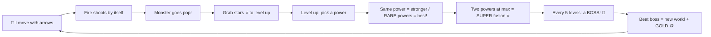
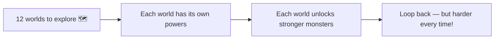
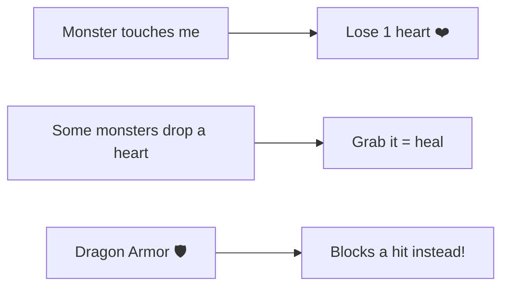

# How Dragon Swarm works (a picture)

## The big adventure

## Hearts (5 only)

> Tip: Monsters get a little stronger every world you clear, so keep buying shop upgrades! RARE powers are golden and extra strong — grab them when they pop up.
